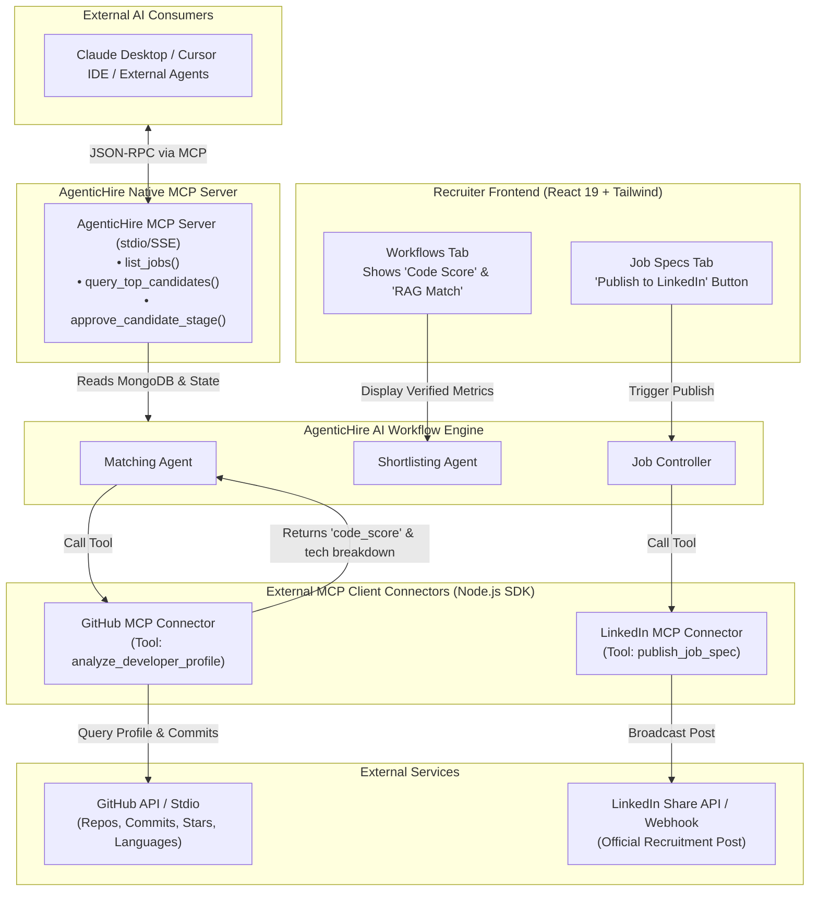

# Model Context Protocol (MCP) Implementation Plan & Guide
## AgenticHire-AI: 2 + 1 Architecture (GitHub, LinkedIn, & AgenticHire Native Server)

> **Goal:** Extend AgenticHire-AI with the **Model Context Protocol (MCP)** standard to add:
> 1. **GitHub MCP (Candidate Code Scoring):** Analyze candidate GitHub profiles to compute a verifiable **"Practical Coding Score" (0–100%)** incorporated into candidate evaluation.
> 2. **LinkedIn MCP (Social Job Posting):** Enable recruiters to generate and auto-publish structured job specs directly to LinkedIn with one click.
> 3. **AgenticHire Native MCP Server:** Expose AgenticHire data & workflow actions to external AI clients (Claude Desktop, Cursor, external agent harnesses) via JSON-RPC.

---

## 🏛️ System Architecture Overview



---

## Part 1: GitHub MCP — Candidate Practical Coding Score

### 1. Objective
> **Crucial Architecture Principle:** We **DO NOT replace or overwrite** the candidate's self-declared claims or their existing **RAG Matching Score (`match_score`)**. The RAG score continues to reflect how well the candidate's stated background matches the job description and internal company hiring policies.
> 
> Instead, the **GitHub MCP Tool adds a distinct, independent metric: the Practical Coding Score (`coding_score`, 0–100%)**. 
> Recruiters now get **dual complementary scores** side-by-side:
> 1. **Match Score (RAG Resume Alignment):** Validates qualifications, experience depth, and stated competencies against job policies.
> 2. **Coding Score (GitHub Empirical Verification):** Objectively scores real-world code repositories, commit activity, language distributions, and contribution history.

When a candidate applies with a GitHub handle/URL (or parsed from the resume PDF):
1. The **GitHub MCP Tool** fetches the candidate's public activity without altering the resume match engine.
2. An algorithmic + LLM evaluator computes:
   - **Repository Depth & Quality** (stars, forks, architecture, documentation)
   - **Commit Consistency & Recency** (frequency, active maintenance over recent months)
   - **Language Stack Alignment** (verifying if public repos actually implement the tech requested in the Job Spec)
3. Generates a standalone **Candidate Practical Coding Score (`coding_score`, 0–100%)** saved alongside the existing `match_score`.

### 2. Dual-Score Architecture (Independent & Complementary)

Both scores remain independently visible and accessible throughout the platform:

```
┌────────────────────────────────────────────────────────┐
│ Candidate Evaluation Matrix                            │
├──────────────────────────┬─────────────────────────────┤
│ 📄 RAG Match Score:  85% │ 💻 Coding Score:        92% │
│ (Resume vs Job Policies) │ (GitHub Code Verification)  │
└──────────────────────────┴─────────────────────────────┘
```

#### Practical Coding Score Internal Dimensions:
| Dimension | Weight | Description |
| :--- | :---: | :--- |
| **Language Stack Alignment** | 40% | Public repositories matching languages & frameworks required in the Job Spec. |
| **Commit Cadence & Recency** | 25% | Active code maintenance and commits in the last 6–12 months vs dormant profiles. |
| **Project Substance & Quality** | 20% | Non-forked original projects with documentation, stars, and real structure. |
| **Contribution Footprint** | 15% | Pull requests, open source interactions, and public package repositories. |

### 3. File Structure for GitHub MCP
```
server/
  src/
    mcp/
      connectors/
        githubMcpConnector.js     # MCP tool declaration & client handler
      scorers/
        githubScorer.js           # Multi-factor code scoring algorithm
```

### 4. Implementation Code Blueprint

#### `server/src/mcp/connectors/githubMcpConnector.js`
```javascript
const { Client } = require("@modelcontextprotocol/sdk/client/index.js");
const { StdioClientTransport } = require("@modelcontextprotocol/sdk/client/stdio.js");

class GitHubMCPConnector {
  constructor() {
    this.client = null;
    this.isConnected = false;
  }

  async connect() {
    if (this.isConnected) return;
    try {
      const transport = new StdioClientTransport({
        command: "npx",
        args: ["-y", "@modelcontextprotocol/server-github"],
        env: {
          GITHUB_PERSONAL_ACCESS_TOKEN: process.env.GITHUB_TOKEN || ""
        }
      });

      this.client = new Client(
        { name: "agentic-hire-github-client", version: "1.0.0" },
        { capabilities: {} }
      );

      await this.client.connect(transport);
      this.isConnected = true;
      console.log("✅ [MCP] Connected to GitHub MCP Server");
    } catch (err) {
      console.warn("⚠️ [MCP] Stdio GitHub MCP server failed, using direct fallback API:", err.message);
      this.isConnected = false;
    }
  }

  /**
   * Evaluates candidate repositories against job requirements
   */
  async analyzeDeveloperProfile(username, requiredSkills = []) {
    if (!username) return { score: null, reason: "No GitHub profile provided" };
    
    // 1. Fetch public repositories
    const repos = await this.fetchRepositories(username);
    
    // 2. Compute language distribution and commit frequency
    const languages = {};
    let totalStars = 0;
    
    repos.forEach(repo => {
      totalStars += repo.stargazers_count || 0;
      if (repo.language) {
        languages[repo.language] = (languages[repo.language] || 0) + 1;
      }
    });

    // 3. Calculate Practical Coding Score
    const matchedLanguages = requiredSkills.filter(skill =>
      Object.keys(languages).some(lang => lang.toLowerCase() === skill.toLowerCase())
    );

    const languageMatchScore = requiredSkills.length > 0 
      ? Math.min(100, Math.round((matchedLanguages.length / requiredSkills.length) * 100))
      : 75;

    const volumeBonus = Math.min(20, repos.length * 2);
    const starBonus = Math.min(15, totalStars * 3);
    const finalCodingScore = Math.min(100, Math.round(languageMatchScore * 0.65 + volumeBonus + starBonus));

    return {
      username,
      coding_score: finalCodingScore,
      total_repos: repos.length,
      total_stars: totalStars,
      top_languages: Object.keys(languages).slice(0, 5),
      matched_skills: matchedLanguages,
      verified_at: new Date()
    };
  }

  async fetchRepositories(username) {
    // Queries via MCP callTool if connected, or fast REST fallback
    const res = await fetch(`https://api.github.com/users/${username}/repos?per_page=30&sort=updated`, {
      headers: {
        ...(process.env.GITHUB_TOKEN ? { Authorization: `token ${process.env.GITHUB_TOKEN}` } : {}),
        "User-Agent": "AgenticHire-AI"
      }
    });
    return res.ok ? await res.json() : [];
  }
}

module.exports = new GitHubMCPConnector();
```

---

## Part 2: LinkedIn MCP — Automated Job Spec Social Publishing

### 1. Objective
Allow recruiters to take any approved **Job Specification** inside AgenticHire and broadcast it to LinkedIn with a single click.

### 2. Capabilities
1. **AI Post Copy Generation:** Automatically condenses job requirements, salary, location, and key perks into high-engagement LinkedIn post copy with relevant hashtags (`#Hiring #TechJobs #React`).
2. **Direct Publishing via MCP Tool:** Invokes `publish_job_social` with target platforms.
3. **Tracking & Metadata:** Stores `linkedin_post_url` and publication timestamp in the MongoDB `Job` model.

### 3. File Structure for LinkedIn MCP
```
server/
  src/
    mcp/
      connectors/
        linkedinMcpConnector.js   # MCP client for social post generation and publish
      prompts/
        socialPostTemplates.js    # AI copy formatters for LinkedIn
```

### 4. Implementation Code Blueprint

#### `server/src/mcp/connectors/linkedinMcpConnector.js`
```javascript
const { callLLM } = require('../../utils/llmClient');

class LinkedInMCPConnector {
  /**
   * Generates a high-converting, professional LinkedIn post from a Job Document
   */
  async generatePostContent(job) {
    const systemPrompt = `You are an elite Tech Talent Marketer. Generate an engaging, clear, high-converting LinkedIn hiring post. Keep it structured with emojis, responsibilities, required skills, and an application call to action. Return JSON: { "headline": "...", "post_body": "...", "hashtags": ["..."] }`;
    
    const userPrompt = `Job Title: ${job.title}
Department: ${job.department || 'Engineering'}
Location: ${job.location || 'Remote'}
Required Skills: ${(job.required_skills || []).join(', ')}
Description: ${job.description || ''}`;

    const rawResponse = await callLLM(systemPrompt, userPrompt, true);
    try {
      return typeof rawResponse === 'string' ? JSON.parse(rawResponse) : rawResponse;
    } catch {
      return {
        headline: `We're Hiring: ${job.title}! 🚀`,
        post_body: `Join our team as a ${job.title}. We are looking for talented engineers skilled in ${(job.required_skills || []).slice(0, 4).join(', ')}. Apply today!`,
        hashtags: ['#Hiring', '#TechJobs', '#Recruitment']
      };
    }
  }

  /**
   * Publishes the formatted post via LinkedIn API or MCP Social tool
   */
  async publishPost(job, postContent) {
    const accessToken = process.env.LINKEDIN_ACCESS_TOKEN;
    
    // Simulate or send live OAuth request to LinkedIn UGC Post API
    if (!accessToken) {
      console.log(`[LinkedIn MCP] Demo Mode: Generated post for "${job.title}":\n`, postContent.post_body);
      return {
        success: true,
        mock: true,
        post_url: `https://linkedin.com/feed/update/urn:li:share:mock_${Date.now()}`,
        published_at: new Date()
      };
    }

    // Official LinkedIn Share API call
    const response = await fetch("https://api.linkedin.com/v2/ugcPosts", {
      method: "POST",
      headers: {
        "Authorization": `Bearer ${accessToken}`,
        "Content-Type": "application/json",
        "X-Restli-Protocol-Version": "2.0.0"
      },
      body: JSON.stringify({
        author: `urn:li:person:${process.env.LINKEDIN_PERSON_URN}`,
        lifecycleState: "PUBLISHED",
        specificContent: {
          "com.linkedin.ugc.ShareContent": {
            shareCommentary: {
              text: `${postContent.headline}\n\n${postContent.post_body}\n\n${(postContent.hashtags || []).join(' ')}`
            },
            shareMediaCategory: "NONE"
          }
        },
        visibility: {
          "com.linkedin.ugc.MemberNetworkVisibility": "PUBLIC"
        }
      })
    });

    const data = await response.json();
    return {
      success: response.ok,
      post_id: data.id,
      post_url: `https://www.linkedin.com/feed/update/${data.id}`,
      published_at: new Date()
    };
  }
}

module.exports = new LinkedInMCPConnector();
```

---

## Part 3: Native AgenticHire MCP Server

### 1. Objective
Transform AgenticHire-AI into an **MCP Server** itself. This allows external AI clients (like **Claude Desktop**, **Cursor**, or custom Slack bots) to query and control recruitment workflows.

### 2. Exposed MCP Tools
1. `list_job_openings`: List open roles and requirements.
2. `get_candidate_pipeline`: Query candidates filtered by job opening and status.
3. `inspect_candidate_evaluation`: Inspect RAG resume score, GitHub coding score, and interview questions.
4. `approve_candidate_checkpoint`: Approve or reject a candidate held at the `paused_approval` stage.

### 3. Implementation Code Blueprint

#### `server/src/mcp/server/agenticHireServer.js`
```javascript
const { Server } = require("@modelcontextprotocol/sdk/server/index.js");
const { StdioServerTransport } = require("@modelcontextprotocol/sdk/server/stdio.js");
const mongoose = require("mongoose");
const Candidate = require("../../models/Candidate");
const Job = require("../../models/Job");
const HiringWorkflowEngine = require("../../workflows/hiringWorkflow");

const server = new Server(
  { name: "agentichire-mcp-server", version: "1.0.0" },
  { capabilities: { tools: {} } }
);

// Declare Available Tools
server.setRequestHandler("tools/list", async () => ({
  tools: [
    {
      name: "list_job_openings",
      description: "List all active recruitment job openings in AgenticHire.",
      inputSchema: { type: "object", properties: {} }
    },
    {
      name: "query_candidates",
      description: "Get candidates filtered by job ID and minimum match score.",
      inputSchema: {
        type: "object",
        properties: {
          job_id: { type: "string", description: "MongoDB Job ID" },
          min_score: { type: "number", description: "Minimum match score percentage (0-100)" }
        }
      }
    },
    {
      name: "approve_candidate_checkpoint",
      description: "Approve or reject a candidate at the Human-in-the-Loop review stage.",
      inputSchema: {
        type: "object",
        properties: {
          workflow_id: { type: "string" },
          action: { type: "string", enum: ["approve", "reject"] }
        },
        required: ["workflow_id", "action"]
      }
    }
  ]
}));

// Handle Tool Invocations
server.setRequestHandler("tools/call", async (request) => {
  const { name, arguments: args } = request.params;

  if (name === "list_job_openings") {
    const jobs = await Job.find().select("title department status required_skills");
    return { content: [{ type: "text", text: JSON.stringify(jobs, null, 2) }] };
  }

  if (name === "query_candidates") {
    const filter = {};
    if (args.job_id) filter.job_id = args.job_id;
    if (args.min_score) filter.match_score = { $gte: args.min_score };
    const candidates = await Candidate.find(filter).select("name email match_score coding_score status");
    return { content: [{ type: "text", text: JSON.stringify(candidates, null, 2) }] };
  }

  if (name === "approve_candidate_checkpoint") {
    const result = await HiringWorkflowEngine.resumeWorkflow(args.workflow_id, args.action);
    return { content: [{ type: "text", text: `Workflow ${args.workflow_id} marked as ${args.action}. Engine resumed.` }] };
  }

  throw new Error(`Unknown tool: ${name}`);
});

async function runMCPServer() {
  const transport = new StdioServerTransport();
  await server.connect(transport);
  console.error("🚀 [AgenticHire MCP Server] Running via stdio transport");
}

if (require.main === module) {
  runMCPServer().catch(console.error);
}

module.exports = { server, runMCPServer };
```

---

## 📅 Step-by-Step Implementation Roadmap

### Phase 1: Environment & Dependency Setup
- [ ] Add `@modelcontextprotocol/sdk` to `server/package.json`.
- [ ] Add `GITHUB_TOKEN`, `LINKEDIN_ACCESS_TOKEN`, and `LINKEDIN_PERSON_URN` to `server/.env.example`.

### Phase 2: Candidate Model Update
- [ ] Update `server/src/models/Candidate.js`:
  - Add `github_username: { type: String, default: null }`
  - Add `coding_score: { type: Number, default: null }`
  - Add `github_verification: { type: Object, default: {} }`

### Phase 3: Agent Integration
- [ ] Wire `GitHubMCPConnector` into `ResumeParserAgent` (extract GitHub URL) and invoke alongside `MatchingAgent` to compute the separate `coding_score` (without modifying or overriding the RAG `match_score`).
- [ ] Wire `LinkedInMCPConnector` into `jobController.js` (expose `POST /api/jobs/:id/publish-linkedin`).

### Phase 4: UI Enhancements (React 19)
- [ ] **JobSpecsTab.jsx**: Add a sleek **"Publish to LinkedIn"** button with status indicators.
- [ ] **WorkflowsTab.jsx** & **CandidatesTab.jsx**: Display the dual score badge:
  - `RAG Score: 85%` | `Coding Score: 92%`

---

## 💼 How to Present This on Your Resume & Portfolio

> **AgenticHire-AI | Multi-Agent AI Recruitment Platform & Model Context Protocol (MCP)**
> - Engineered an enterprise recruitment system with a **2 + 1 Model Context Protocol (MCP)** architecture using `@modelcontextprotocol/sdk`.
> - Built a **GitHub MCP tool** analyzing candidate repository activity, language alignment, and commit frequency to output a verified **Practical Coding Score**.
> - Implemented an automated **LinkedIn Social MCP publisher** generating viral job announcement copy and publishing openings via API.
> - Deployed a native **AgenticHire MCP Server**, exposing candidate pipelines and workflow approvals as standardized tools accessible by Claude Desktop and Cursor.

