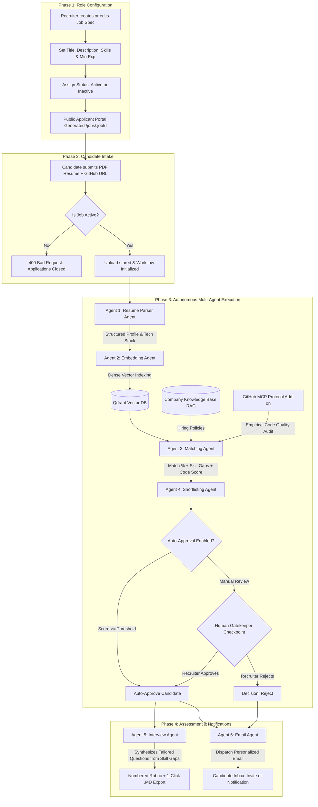

# AgentHire AI — Autonomous Recruitment Operating System

> An enterprise-grade, multi-agent autonomous hiring platform that transforms resume screening, empirical GitHub code verification via Model Context Protocol (MCP), company policy RAG matching, dynamic technical interview rubrics, and automated candidate updates.

---

## 📌 Project Overview

**AgentHire AI** replaces traditional keyword-based applicant tracking systems (ATS) with an event-driven orchestration of **6 specialized autonomous AI agents** connected by a persistent state machine:

1. **Resume Parser Agent**: Extracts text, contact info, experience, and discovers GitHub portfolio URLs.
2. **Embedding Agent**: Chunks resumes and ingests dense vector embeddings into **Qdrant Vector Database**.
3. **Matching Agent (with GitHub MCP Protocol Add-on)**:
   - Evaluates candidate suitability against required skills and internal **Knowledge Base RAG policies**.
   - Invokes the **GitHub MCP Protocol** to empirically audit genuine public git repositories, commit recency, testing patterns, and language alignment.
4. **Shortlisting Agent**: Evaluates qualification scores against recruitment thresholds and executes automated pass/hold/reject decisions or pauses for **Human Gatekeeper** review.
5. **Interview Agent**: Dynamically synthesizes customized technical interview questions targeting candidate-specific skill gaps, with structured questions and 1-click Markdown export.
6. **Email Agent**: Formats and dispatches automated interview invitations and polite rejection notices with zero candidate ghosting.

All agent telemetry, state changes, and JSON execution logs stream live via **RFC 6455 WebSockets** with zero page refreshes required.

---

## 🔄 End-to-End Platform Flow

The complete hiring lifecycle is structured into a streamlined 4-phase workflow:



---

## 🤖 The 6 Autonomous AI Agents

| Agent | Name | Role & Execution Responsibility | Output Artifact |
| :---: | :--- | :--- | :--- |
| **01** | **Resume Parser Agent** | Ingests PDF binary, performs OCR/parsing, normalizes experience timelines, extracts contact info and identifies portfolio links. | Structured JSON schema (`name`, `email`, `phone`, `skills`, `github_url`) |
| **02** | **Embedding Agent** | Segments candidate profile into overlapping chunks, generates 384-dimensional dense vectors, and upserts into Qdrant. | Dense cosine embeddings stored in collection |
| **03** | **Matching Agent** *(+ GitHub MCP)* | Cross-references candidate vectors with Job requirements and internal Knowledge Base standards. Calls the **GitHub MCP Connector** to audit genuine commits and calculate an empirical coding score. | Match Score %, Coding Score %, Identified Skill Gaps array |
| **04** | **Shortlisting Agent** | Compares composite scores against defined recruitment thresholds. Evaluates **Auto-Approval** conditions or pauses at the Human-in-the-Loop review checkpoint. | Status: `shortlist`, `hold`, or `reject` |
| **05** | **Interview Agent** | Takes identified skill gaps and generates tailored technical interview questions with evaluation criteria. | Structured question cards & 1-Click Markdown Rubric |
| **06** | **Email Agent** | Dynamically interpolates candidate name, role title, and timeline into notification templates and dispatches automated emails. | Sent status via Resend / SMTP |

---

## ⚡ Key Architectural Capabilities

### 1. Empirical Code Verification via GitHub MCP
- Bypasses resume keyword stuffing by using the **Model Context Protocol (MCP)**.
- Evaluates candidates across 4 weighted dimensions:
  - **Language Alignment (40%)**: Verified code in required job technologies.
  - **Commit Recency & Velocity (25%)**: Active git activity in the last 6–12 months.
  - **Project Quality & Depth (20%)**: Originality, documentation, and AST complexity.
  - **Contribution Footprint (15%)**: Stars, forks, and community impact.

### 2. Company Knowledge Base & RAG Grounding
- Recruiters can upload internal hiring standards, culture docs, and role-specific rubrics.
- Ingested policies dynamically calibrate Agent 3's evaluations, ensuring hiring decisions match internal organizational criteria.

### 3. Auto-Approval Automation & Instant Re-Run
- **Auto-Approval Toggle**: Automatically advances candidates surpassing the configurable threshold (e.g. $\ge 80\%$) straight through to interview generation.
- **Instant Re-Run Engine**: Allows recruiters to update job specs or hiring policies and re-evaluate candidate pools with 1-click without requiring candidates to re-upload resumes.

### 4. Active / Inactive Job Lifecycle
- Recruiter dashboard allows editing job specifications and toggling status between **Active** and **Inactive**.
- When marked Inactive, the public application portal disables submissions with a clean *"Applications Closed"* state, and the backend rejects incoming submissions.

### 5. Dual-Engine LLM Runtime (Cloud & Local Offline)
- **High-Throughput Cloud**: Groq Cloud (`llama-3.3-70b-versatile`) or OpenRouter for sub-second responses.
- **Private Air-Gapped Local**: Offline Ollama runtime (`llama3.2:3b` / `llama3:8b`) for complete data privacy with zero external API calls.

---

## 💻 Technology Stack

| Category | Technology | Purpose in Platform |
| :--- | :--- | :--- |
| **Frontend** | React 19, Vite, Tailwind CSS | High-performance responsive recruiter dashboard and candidate portal. |
| **State & Navigation** | Zustand, React Router 7 | Client-side session management and role-based routing. |
| **Real-time Telemetry** | Native WebSockets (`ws`) | RFC 6455 live streaming of agent states, telemetry, and live terminal logs. |
| **Backend Engine** | Node.js, Express 5 | RESTful API, multer PDF ingest, and asynchronous workflow execution engine. |
| **Document Store** | MongoDB Atlas, Mongoose 9 | Users, Job Specs, Candidate records, Workflow execution checkpoints, and audit logs. |
| **Vector Database** | Qdrant Cloud | High-speed semantic vector search across resumes and company RAG policies. |
| **Protocol Integration**| Model Context Protocol (MCP) | Direct standard integration with GitHub for empirical code audits. |
| **Email Service** | Resend API / Spec Loader | Automated candidate interview invitations and rejection notices. |

---

## ⚙️ Quickstart & Local Setup

### 1. Prerequisites
- **Node.js** v18+ and **npm**
- **MongoDB** (local or Atlas URI)
- **Qdrant** (Cloud instance or local Docker container)
- *(Optional)* **Ollama** installed locally for air-gapped local model execution.

### 2. Clone Repository & Install Dependencies
```bash
git clone https://github.com/adityakurhade1000/AgenticHire-AI.git
cd AgenticHire-AI

# Install backend dependencies
cd server
npm install

# Install frontend dependencies
cd ../client
npm install
```

### 3. Configure Environment Variables
Create a `.env` file in `server/`:
```env
PORT=5000
MONGODB_URI=your_mongodb_connection_string
JWT_SECRET=your_jwt_secret_key

# Cloud LLM Provider Keys
GROQ_API_KEY=your_groq_api_key
OPENROUTER_API_KEY=your_openrouter_api_key

# Qdrant Vector Cloud
QDRANT_URL=your_qdrant_cloud_url
QDRANT_API_KEY=your_qdrant_api_key

# Email Notifications
RESEND_API_KEY=your_resend_api_key

# Workflow Automation Defaults
AUTO_APPROVAL_ENABLED=false
AUTO_APPROVAL_THRESHOLD=80
```

### 4. Run Development Servers
Open two terminal windows:

**Terminal 1 — Backend & Realtime WebSocket Server:**
```bash
cd server
npm run dev
```
*API runs on `http://localhost:5000` with WebSockets active on `ws://localhost:5000/ws`.*

**Terminal 2 — Frontend Application:**
```bash
cd client
npm run dev
```
*Frontend runs on `http://localhost:5173`.*

---

## 🧪 How to Test the Platform End-to-End

1. **Create a Job Specification**:
   - In the dashboard, open **Job Specs** and click **+ New Job Spec**.
   - Fill in Job Title (e.g. *Full Stack Developer*), Description, Min Experience, and Required Skills (e.g. *React, Node.js, Express*). Ensure status is set to **Active**.
2. **Submit a Candidate Application**:
   - Open the **Public Portal** link for the created job.
   - Upload a sample PDF resume and provide a public GitHub URL (e.g. `https://github.com/your-username`).
3. **Inspect the Autonomous Multi-Agent Pipeline**:
   - Navigate to the **AI Workflows** tab in the Recruiter Dashboard.
   - Watch the live execution graph update in real-time as each of the **6 agents** execute:
     - **Resume Parser** extracts details.
     - **Embedding Agent** indexes vectors into Qdrant.
     - **Matching Agent** compares candidate against specs and triggers the **GitHub MCP Protocol** to verify actual repositories.
     - **Shortlisting Agent** checks thresholds.
     - Review at the **Human Approval** checkpoint (or toggle **Auto-Approval**).
     - Inspect the synthesized **Technical Assessment & Rubric** with 1-click Markdown export.
     - Confirm automated dispatch in the **Email Agent**.

---

## 📁 Repository Directory Structure

```text
AgenticHire-AI/
├── specs/                          # Specification-driven configuration rules
│   ├── email/templates.json        # Dynamic candidate notification templates
│   ├── evaluation/shortlisting...  # Scoring thresholds (shortlist, hold, reject)
│   ├── system/rag-settings.json    # Vector dimensions, distance metrics, and chunk size
│   └── workflow/default-hiring...  # Ordered agent execution sequences
├── server/                         # Backend Application
│   ├── src/
│   │   ├── agents/                 # 6 Autonomous AI Agent implementations
│   │   │   ├── resumeParserAgent.js
│   │   │   ├── embeddingAgent.js
│   │   │   ├── matchingAgent.js
│   │   │   ├── shortlistingAgent.js
│   │   │   ├── interviewAgent.js
│   │   │   └── emailAgent.js
│   │   ├── mcp/                    # Model Context Protocol (MCP) GitHub connector
│   │   ├── rag/                    # Dense embedding chunker, Qdrant indexer & retriever
│   │   ├── services/               # Native RFC 6455 WebSocket broadcast engine
│   │   ├── workflows/              # Workflow engine with retry policy & checkpoints
│   │   ├── models/                 # Mongoose schemas (Job, Candidate, Workflow, User)
│   │   ├── routes/                 # Express API routes (Jobs, Candidates, Workflow, Auth)
│   │   └── index.js                # Server entrypoint (HTTP + WebSockets)
└── client/                         # Vite + React 19 Frontend
    └── src/
        ├── components/dashboard/   # Dashboard tabs (Overview, JobSpecs, Candidates, Workflows, KnowledgeBase, Analytics)
        ├── hooks/                  # useRealtimeWorkflow WebSocket hook
        └── pages/                  # Home, Dashboard, JobDetails, ApplyJob, Login, Signup
```

---

## 📜 License
This project is open-source under the [ISC License](LICENSE).
