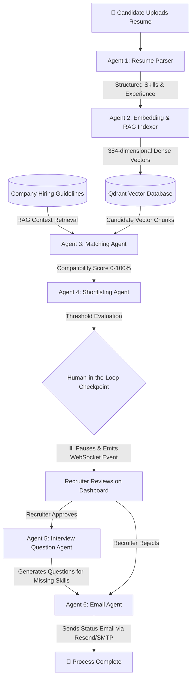

# AgenticHire-AI

> An intelligent, multi-agent recruitment platform that automates candidate screening, semantic matching using company policies, and real-time candidate evaluation.

---

## 📌 Project Overview

**AgenticHire-AI** is an AI-powered recruitment operating system built to replace traditional, keyword-based hiring tools. 

Instead of relying on a single AI prompt or basic keyword matching, the platform uses **six specialized AI agents** that work together in an ordered workflow:
1. Extract candidate information from resume PDFs into structured data.
2. Convert resumes into vector embeddings for semantic search.
3. Use **RAG (Retrieval-Augmented Generation)** to compare the candidate against actual company hiring guidelines and job requirements.
4. Score the candidate and determine if they should be shortlisted, held, or rejected.
5. Pause at a **Human-in-the-Loop** checkpoint so the recruiter can review and make the final decision.
6. Generate personalized technical interview questions and automatically dispatch candidate emails.

All agent progress and execution logs are streamed live to the recruiter's dashboard via **WebSockets**, meaning the user never has to refresh the page to see live updates.

---

## 🏛️ System Architecture

### Workflow Lifecycle



---

## 💻 Technology Stack

| Category | Technology | Purpose in Project |
| :--- | :--- | :--- |
| **Frontend UI** | **React 19, Vite, Tailwind CSS** | Fast, responsive recruiter dashboard and candidate job application portal. |
| **State Management** | **Zustand** | Lightweight client-side authentication and filter state management. |
| **Real-Time Communication** | **WebSockets (Native RFC 6455 & `ws`)** | Pushes live agent progress, status changes, and terminal logs to the browser instantly. |
| **Backend API** | **Node.js, Express 5** | RESTful API server, PDF upload parsing, and workflow execution engine. |
| **Relational / Document DB** | **MongoDB Atlas, Mongoose 9** | Stores users, job specifications, candidate profiles, workflow checkpoints, and logs. |
| **Vector Database** | **Qdrant Cloud** | Stores 384-dimensional dense vector embeddings for semantic search across resumes and policies. |
| **LLM & AI Inference** | **Groq Cloud, OpenRouter, Local Ollama** | Multi-provider LLM support with high-speed cloud inference and 100% offline local model fallback. |
| **Email Service** | **Resend API / SMTP** | Dispatches automated interview invitations and polite rejection emails. |
| **Document Processing** | **`pdf-parse`, `multer`** | Extracts raw text from uploaded candidate PDF resumes safely. |

---

## 🚀 Key Features

### 1. Autonomous Multi-Agent Pipeline
Rather than relying on one huge AI prompt that can miss instructions or hallucinate, the workload is divided into discrete agents:
* **Resume Parser Agent**: Extracts candidate name, email, phone, years of experience, technical skills, projects, and education.
* **Embedding Agent**: Breaks text into overlapping chunks and generates 384-dimensional dense vectors.
* **Matching Agent**: Evaluates the candidate against required and preferred skills using company hiring policies.
* **Shortlisting Agent**: Compares match scores against defined threshold specifications (`shortlist`, `hold`, `reject`).
* **Human Approval Checkpoint**: Pauses the workflow so a recruiter can review before any external action is taken.
* **Interview & Email Agent**: Generates custom interview questions focusing on candidate skill gaps and dispatches notification emails.

### 2. Retrieval-Augmented Generation (RAG) Knowledge Base
* **Company Standards Grounding**: Recruiters can upload internal hiring standards, department requirements, and diversity rubrics directly into the vector database.
* **Semantic Talent Search**: Recruiters can query candidate resumes using natural language (e.g. *"Show me candidates with strong microservices and state management experience"*) and receive results ranked by cosine similarity.
* **Job Opening Filtering**: Filter candidate vector searches by specific job vacancies.

### 3. Real-Time Telemetry via WebSockets (Zero Page Reloads)
* Uses native WebSockets attached directly to the Express server on port 5000.
* As background agents execute, events like `workflow:node_start`, `workflow:node_success`, and `workflow:paused_approval` are broadcast to the frontend.
* The execution graph nodes update colors and the terminal log stream appends output live without the user needing to refresh the page.

### 4. Resilient Dual-LLM & Offline Fallback Architecture
* **Fast Cloud Mode**: Connects to Groq Cloud (`llama-3.3-70b-versatile`) or OpenRouter for sub-second responses.
* **Private Offline Mode**: Automatically falls back to a locally running Ollama instance (`llama3:8b`) if external APIs are unavailable or rate-limited.
* **Vector Store Fallback**: If the Qdrant Cloud network connection times out, the system automatically uses an in-memory cosine similarity engine so candidate scoring never fails.

---

## ⚙️ How to Setup and Run

### 1. Clone Repository & Install Dependencies
```bash
# Clone the repository
git clone https://github.com/adityakurhade1000/AgenticHire-AI.git
cd AgenticHire-AI

# Install backend dependencies
cd server
npm install

# Install frontend dependencies
cd ../client
npm install
```

### 2. Configure Environment Variables
Create a `.env` file in the project root:
```env
PORT=5000
MONGODB_URI=your_mongodb_connection_string
JWT_SECRET=your_jwt_secret_key

# LLM Keys
GROQ_API_KEY=your_groq_api_key
OPENROUTER_API_KEY=your_openrouter_api_key

# Qdrant Vector Cloud
QDRANT_URL=your_qdrant_cloud_url
QDRANT_API_KEY=your_qdrant_api_key

# Email
RESEND_API_KEY=your_resend_api_key
```

### 3. Start the Application
Open two terminal windows:

**Terminal 1 (Backend & WebSocket Server):**
```bash
cd server
npm run dev
```
*Server runs on `http://localhost:5000` with WebSockets at `ws://localhost:5000/ws`.*

**Terminal 2 (Frontend Client):**
```bash
cd client
npm run dev
```
*Frontend runs on `http://localhost:5173`.*

---

## 📁 Project Directory Structure

```text
AgenticHire-AI/
├── specs/                          # Specification-driven configuration rules
│   ├── email/templates.json        # Email templates
│   ├── evaluation/shortlisting...  # Scoring thresholds (shortlist, hold, reject)
│   ├── system/rag-settings.json    # Vector dimensions and chunk sizes
│   └── workflow/default-hiring...  # Sequence of agent execution
├── server/                         # Backend Application
│   ├── src/
│   │   ├── agents/                 # 6 Autonomous AI Agent implementations
│   │   ├── rag/                    # Chunker, Embedder, Indexer, and Retriever
│   │   ├── services/               # WebSocket Server broadcaster
│   │   ├── workflows/              # Workflow orchestration engine
│   │   ├── models/                 # MongoDB Mongoose schemas
│   │   ├── routes/                 # REST API endpoints
│   │   └── index.js                # Server entrypoint (HTTP + WebSockets)
└── client/                         # React Frontend Application
    └── src/
        ├── components/dashboard/   # Dashboard tabs (Overview, Workflows, Candidates, KnowledgeBase)
        ├── hooks/                  # useRealtimeWorkflow WebSocket hook
        └── pages/                  # Main pages (Dashboard, JobDetails, ApplyJob)
```

---

## 📜 License
This project is open-source and licensed under the [ISC License](LICENSE).
